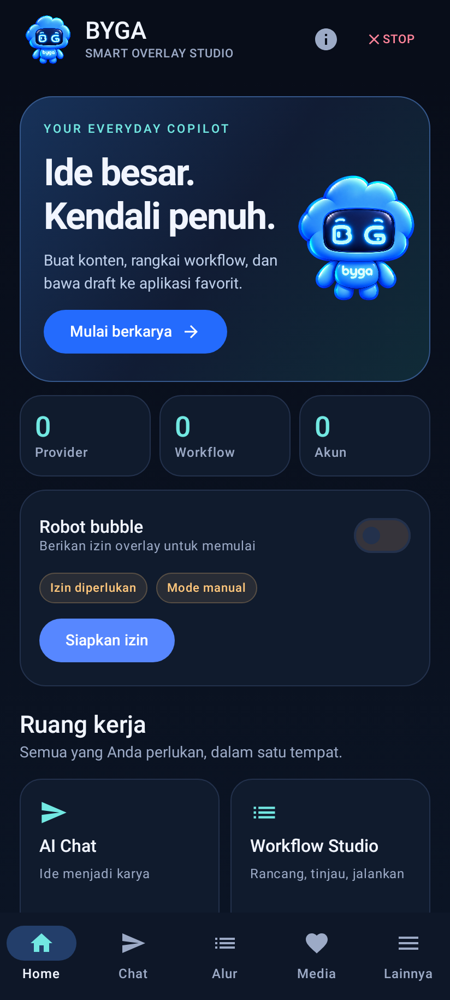

# BYGA Smart Overlay — Studio

Asisten produktivitas Android berbahasa Indonesia: dashboard navy/cyan, robot bubble, AI Chat, workflow yang direview, serta studio draft sosial. Orkestrasi dan data berada di HP; provider AI dihubungi langsung melalui HTTPS. Tidak ada backend pribadi, root, Shizuku, atau kebutuhan ADB untuk penggunaan aplikasi.

**Rilis 0.6.0 Smart Mapping adalah pengembangan fungsional, bukan klaim PRD selesai 99,9%.** Build/test cloud tidak membuktikan kompatibilitas aplikasi target atau Samsung. Lihat [status PRD](docs/IMPLEMENTATION_STATUS.md) dan [matriks uji](docs/TEST_MATRIX.md). Baseline asli tetap utuh: [PRD v1](docs/PRD.md), [PRD v2](docs/PRD_v2.md).

## Memperoleh APK

Buka **GitHub → Actions → Android Optimized APK and Runtime QA → run sukses → Artifacts → BYGA-Smart-Overlay-optimized**. Ekstrak ZIP, transfer `app-optimized.apk` ke HP dan instal melalui installer Android. Debug signing key pada runner berbeda dapat berbeda; update yang ditolak installer mungkin memerlukan uninstall (menghapus data lokal). Tidak ada release-signing key atau API key dalam CI.

## Yang dapat digunakan

- **Dashboard & navigasi:** hero robot, status izin/bubble aktual, hitungan data tersimpan, shortcut dan navigasi bawah. Lainnya membuka seluruh workspace. Tombol Stop di toolbar membatalkan chat/workflow/agent/capture dan menutup bubble.
- **Smart Mapping:** deteksi tombol dan mode tunjuk dari bubble; review Simpan/Uji/Batal, identitas per aplikasi/situs/layar, library lokal, binding versi ke workflow, serta posisi manual dengan konfirmasi wajib. Target awal: ChatGPT native, Chrome ChatGPT/Flow, browser BYGA dan area latihan. [Cara pakai dan batas](docs/SMART_MAPPING.md); kompatibilitas aplikasi nyata masih NEEDS_REAL_DEVICE.
- **Robot bubble:** maskot BG/byga sesuai referensi, PNG transparan, ukuran visual 24–56dp (default kecil 28dp, area ketuk minimal 48dp), drag/dock, panel prompt/clipboard/share, long-press dan notification Stop, serta panel scrollable. Input manual ke kolom fokus di BYGA/ChatGPT/Claude/TikTok/Instagram memakai review teks/akun/target dan permit single-use 10 detik; tidak menekan Kirim. Atur di Settings.
- **AI Chat:** provider/model tersimpan, percakapan multi-turn lokal, consent outbound, fallback opsional maksimal tiga provider, batas request harian, cancellation, riwayat/delete, copy dan kirim hasil ke draft sosial. Limit menghitung reservasi percobaan AI Chat/Workflow, bukan biaya dolar; Agent Lab/health test terpisah.
- **Providers:** OpenAI, Anthropic, Gemini, OpenRouter, Groq, Cohere, Hugging Face, Mistral, NVIDIA NIM, custom HTTPS. Picker model saran/live/manual. API key AES-GCM Android Keystore. [Panduan](docs/PROVIDERS.md).
- **Prompt Library:** banyak template, tag/search/favorite, edit/copy, gunakan di Chat atau draft. Tidak ada request otomatis saat membuka template.
- **Workflow Studio:** pemilih aplikasi terinstal, editor/template/JSON, dry run, hash review, pause/resume/stop dan checkpoint. Tersedia alur ChatGPT Web (prompt → salin teks atau unduh gambar), Google Flow (proyek → unggah gambar → prompt → generate → unduh video), serta gambar ChatGPT → video Flow. Browser BYGA memakai sesi akun situs; login/mode/crop mungkin perlu manual dan login WebView dapat ditolak. Adapter situs asli masih NEEDS_REAL_DEVICE. [Panduan dan batas workflow](docs/WORKFLOW_WEB.md). Aksi lokal/provider sebelumnya tetap tersedia; checkpoint web tidak di-resume otomatis.
- **Accounts:** package/label/alias, guided launch untuk switch/login resmi, status UNKNOWN/NEEDS_LOGIN/USER_CONFIRMED. Konfirmasi pengguna berlaku 5 menit dan bukan deteksi akun otomatis.
- **Media & Social:** SAF picker, preview gambar, caption/hashtag, library draft, account binding, review dialog dan targeted sharesheet Instagram/TikTok. HANDED_OFF **bukan PUBLISHED**; final posting tetap oleh pengguna di app tujuan.
- **Downloads:** URL HTTPS langsung, batas 50MB, MIME/signature check, MediaStore pending/file verification. Login/redirect/format tak didukung ditolak.
- **Scheduler:** banyak pengingat one-time WIB/recurring >=15 menit, priority list, dependensi yang menunggu konfirmasi manual, pause/delete/history. OS boleh menunda; tidak menjanjikan exact minute atau urutan OS. Worker hanya notifikasi/WAITING_FOR_USER.
- **Screen Capture:** MediaProjection satu sesi setelah dialog sistem; foreground service, app allowlist/keyguard/field checks best effort, bubble ditutup, cache privat dan preview. Tidak ada upload AI otomatis. Analisis Vision opsional dan sharesheet masing-masing memerlukan consent kedua. Cache >24 jam dibersihkan pada sesi berikutnya. FLAG_SECURE tetap diproteksi Android; browser tidak diizinkan karena domain belum diverifikasi.
- **Agent Lab/Skills/Memory:** flag OFF default, scope sesi, observe/act/verify kolom uji BYGA, immutable grants, skill test/review/enable, memory manual opt-in/search/delete/export. Kontrol pihak ketiga belum diaktifkan.
- **Settings:** reduce motion, preview/size bubble, backup konfigurasi tanpa key/chat/capture, import inert dengan ID baru dan konfirmasi akun direset. Ekspor maksimal 100 entri; ekspor per workflow tersedia untuk library lebih besar.

## Mulai pada HP

1. Buka **Lainnya → Izin & Onboarding**. Atur overlay dan notifikasi. Accessibility opsional untuk uji input/capture; baca disclosure sebelum Settings sistem. Android sideload dapat meminta **Info aplikasi → ⋮ → Izinkan setelan terbatas** melalui pengaturan resmi.
2. Di AI Providers, pilih provider, isi key/model, simpan terenkripsi. Model discovery bukan jaminan akses/kuota. Health test mengirim prompt kecil dan bisa berbiaya.
3. Buka AI Chat, pilih model, tinjau consent dan request limit, lalu kirim. Hasil bisa dijadikan draft sosial.
4. Di Accounts, buat profil akun tujuan; buka app resmi dan periksa handle. Konfirmasi manual hanya setelah melihatnya. Di Media, pilih file/caption/akun, review, lalu lanjutkan draft ke app tujuan. Periksa akun lagi sebelum posting.
5. Di Workflow Studio, pilih template, edit dan dry run, pilih provider/consent bila ada langkah AI. Review hash lalu Jalankan. Approval step menunggu tombol persetujuan; checkpoint uncertain harus diperiksa manual, tidak diulang otomatis.
6. Di Scheduler, pilih workflow tersimpan dan jadwal. Izinkan notifikasi. UI selalu memerlukan tindakan pengguna dan tidak auto-unlock.
7. Input manual target: fokuskan kolom draft pada aplikasi yang diizinkan, ketuk bubble, masukkan teks, review target/akun, centang consent lalu **Isi kolom fokus**. SUCCESS hanya setelah nilai field terverifikasi; NOT_FOUND/BLOCKED/UNKNOWN bukan sukses. Jika tidak kompatibel, gunakan Salin/Share manual.
8. Capture: pilih target yang diizinkan, beri consent aplikasi dan sistem per sesi. Kembali ke Screen Capture/notification untuk preview; jangan berbagi data login/OTP/keuangan. Hapus gambar jika tidak diperlukan. Untuk analisis provider, aktifkan kemampuan Vision pada model yang mendukung gambar, tinjau preview dan consent kedua; request gambar dikirim hanya setelah konfirmasi Anda.

Rilis 0.6.2 memakai APK optimized (R8, resource shrinking, non-debuggable), pembaruan bubble satu kali per frame, gambar robot tersampel/cache, chat lazy dan riwayat berpaginasi dari SQL. Diagnostik frame lokal ada di **Lainnya → Settings → Performa & versi**. Build optimized pribadi memakai debug signing; untuk distribusi resmi, pasang signing key milik Anda. Tes emulator Android 15/16 dan metrik frame diunggah pada Actions.

Perbaikan responsivitas dan langkah uji HP: [RESPONSIVENESS.md](docs/RESPONSIVENESS.md).

## Build & QA

JDK 17 lengkap, SDK platform 36, Build Tools 36.0.0 (AGP dapat memakai default 35), lisensi SDK diterima. Gradle 8.13/AGP 8.11.1/Kotlin 2.1.20.

```sh
export JAVA_HOME=/path/to/jdk-17
export ANDROID_HOME=/path/to/android-sdk
./gradlew testDebugUnitTest assembleDebug lintDebug
```

Cloud snapshot: `./scripts/cloud-build.sh testDebugUnitTest assembleDebug assembleDebugAndroidTest lintDebug` mengaktifkan `/workspace/toolchains` dan proxy/CA JVM. TLS/checksum tetap aktif. APK: `app/build/outputs/apk/debug/app-debug.apk`.

`./gradlew connectedDebugAndroidTest` memerlukan emulator/HP QA, bukan bagian unit test biasa. Storage/Keystore/migration, atomic request-budget dan native UI smoke tests disediakan. UI test menulis screenshot di app external files khusus perangkat uji. Jangan jalankan pada perangkat dengan data produksi tanpa meninjau efek test.

Dokumentasi: [Smart Mapping dan logo](docs/SMART_MAPPING.md), [workflow aplikasi/ChatGPT/Flow](docs/WORKFLOW_WEB.md), [rilis Studio](docs/STUDIO_ARCHITECTURE.md), [keamanan/privasi](docs/PRIVACY.md), [status implementasi](docs/IMPLEMENTATION_STATUS.md), [kompatibilitas](docs/COMPATIBILITY.md), [changelog](docs/CHANGELOG.md).

## Preview UI dari kode Compose

Render JVM SDK 35 (Robolectric/native Canvas), bukan screenshot HP Samsung atau bukti kompatibilitas aplikasi lain:


